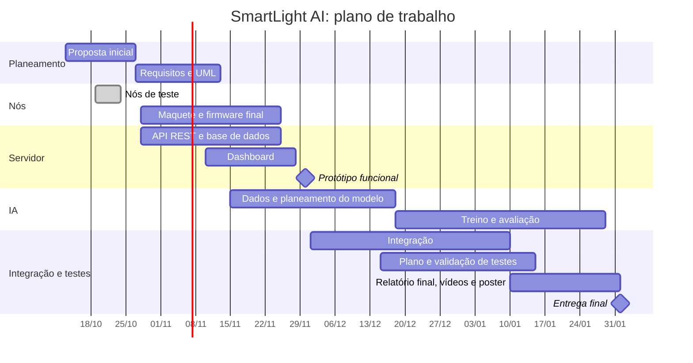

# SmartLight AI: proposta inicial

Iluminação inteligente para casa, com IoT e IA

Universidade Europeia, IADE, Faculdade de Design, Tecnologia e Comunicação

Licenciatura em Engenharia Informática, 5.º semestre, 2026/2027

Grupo g04: Diego Silva, Francisco Maia, Luís Carvalho e Ricardo Siqueira

Unidades curriculares: Sistemas Distribuídos, Computação Física e IoT, Inteligência Artificial e Engenharia de Software

Palavras-chave: IoT, ESP32, iluminação inteligente, sistemas distribuídos, REST, MySQL, previsão de consumo

Repositório: https://github.com/LCarvalhoIADE/smartlight

1.ª entrega, 27 de outubro de 2026

## 1. Descrição do projeto

### Problema

Em muitas casas, as luzes ficam acesas em divisões vazias ou mantêm a mesma intensidade mesmo quando há luz natural suficiente. Além disso, nem sempre é fácil perceber quanto se gasta em iluminação, porque esse consumo não aparece separado na fatura de eletricidade.

### Solução proposta

O SmartLight AI é um sistema que controla a iluminação de forma automática, recolhe dados sobre a sua utilização e prevê o consumo. A solução inclui:

- nós ESP32 que detetam presença, medem a luz ambiente e regulam a intensidade dos LEDs por PWM;
- um servidor que recebe as leituras por REST, sobre HTTPS, e as guarda numa base de dados MySQL;
- um módulo de IA que combina os dados dos nós com dados meteorológicos para prever o consumo da iluminação;
- um dashboard web onde se consulta o estado dos nós, o histórico, as previsões e os alertas.

O controlo da iluminação é feito no próprio nó, sem depender do Wi-Fi nem do servidor. Se a ligação falhar, o nó guarda as leituras e envia-as quando a ligação voltar.

Os nós ficam instalados em casas de elementos do grupo, para recolher dados em condições reais.

### Objetivos

1. Acender e regular a luz de acordo com a presença e a luz ambiente, para que não fique ligada sem necessidade.
2. Recolher dados de várias casas e guardar as leituras durante falhas da rede ou do servidor, para as enviar mais tarde.
3. Medir ou estimar o consumo da iluminação em cada nó.
4. Desenvolver um modelo de previsão do consumo, avaliar os seus resultados face a uma previsão simples de referência e gerar alertas quando o consumo observado se afastar do previsto.
5. Mostrar o estado dos nós, o histórico, as previsões e os alertas num dashboard que possa ser consultado no computador ou no telemóvel.

### Motivação

Escolhemos a iluminação porque se constrói e testa com material de baixo custo e porque o efeito de cada decisão se vê de imediato: quando alguém entra, a luz acende, e quando entra luz natural, a intensidade baixa.

O tema permite também juntar as quatro UCs no mesmo projeto: a montagem e programação dos nós, a comunicação com o servidor, o tratamento dos dados e a previsão do consumo, a definição de requisitos e os testes.

### Testes iniciais

Para validar a ideia, instalámos três nós de teste em casas de elementos do grupo. Cada nó deteta presença, mede a luz ambiente, controla um LED e envia uma leitura a cada 15 segundos para um servidor de teste. Quando a ligação falha, as leituras ficam guardadas no nó e são enviadas mais tarde.

## 2. Público-alvo

O público principal são pessoas e famílias que querem gastar menos em iluminação sem terem de pensar em apagar cada luz.

Há ainda dois públicos secundários:

- senhorios e gestores de alojamento local, que pagam a energia de casas onde não estão;
- pequenos escritórios e lojas, com divisões vazias durante parte do dia.

O utilizador de referência é uma pessoa sem conhecimentos técnicos que consulta o estado da luz e o consumo no telemóvel.

## 3. Guiões de teste (versão preliminar)

### Guião 1: chegar a uma divisão

1. A Ana chega a casa ao fim da tarde. A sala está vazia, com pouca luz, e a luz está apagada.
2. Entra na sala. A luz acende em menos de um segundo.
3. Abre a persiana e entra luz natural. A intensidade da luz baixa sozinha.
4. Sai da sala. Passado o tempo definido sem presença, a luz apaga.

### Guião 2: consultar o consumo

1. No dia seguinte, a Ana abre o dashboard no telemóvel.
2. Vê o estado atual de cada divisão: com ou sem presença e a intensidade da luz.
3. Abre o histórico do dia anterior e vê a que horas a luz esteve acesa e quanto gastou.
4. Consulta a previsão de consumo para o dia seguinte.

### Guião 3: falha da ligação

1. A ligação Wi-Fi da casa da Ana falha durante alguns minutos.
2. Durante esse tempo, a luz continua a acender e a apagar como antes.
3. Quando a ligação volta, a Ana abre o dashboard.
4. O histórico mostra também o período sem ligação, sem falhas nem leituras repetidas.

## 4. Enquadramento nas unidades curriculares

| UC | Contributo para o projeto |
|---|---|
| Sistemas Distribuídos | Gestão do projeto, arquitetura cliente-servidor, infraestrutura do servidor na cloud, API REST, vários nós a enviar dados, recuperação de falhas e leituras sem duplicados. |
| Computação Física e IoT | Programação do ESP32, sensores e atuadores, controlo local da luz, envio dos dados para a cloud por REST, estrutura da base de dados e protocolo REST. |
| Inteligência Artificial | Integração dos dados dos nós com dados meteorológicos, tratamento e qualidade dos dados, escolha de variáveis, modelo de previsão do consumo, avaliação do erro e deteção de consumos anormais. |
| Engenharia de Software | Requisitos funcionais e não funcionais, guiões de teste, modelação UML, plano e validação de testes. |

## 5. Requisitos técnicos e tecnologias (provisórios)

### Hardware

| Material | Função |
|---|---|
| ESP32 DevKit ou ESP32-S3 | Placa do nó |
| Sensor de presença (PIR HC-SR501, ultrassónico HC-SR04 ou radar LD2410C) | Deteção de presença |
| Sensor de luz (fotoresistência, módulo de luz ou BH1750) | Luz ambiente |
| INA219 | Medição do consumo da iluminação |
| Ecrã OLED 0,96" I2C | Estado do nó |
| LEDs e resistências | Iluminação |
| Breadboard e fios | Montagem |

### Software e serviços

| Componente | Tecnologia |
|---|---|
| Firmware dos nós | C++, com PlatformIO ou Arduino IDE |
| Comunicação | REST sobre HTTPS, com dados em JSON |
| Servidor e base de dados | PHP 8 e MySQL, em Docker, numa máquina virtual na cloud |
| IA | Python, com pandas e scikit-learn |
| Dados meteorológicos | Open-Meteo |
| Controlo de versões | Git e GitHub |

### Requisitos principais

- O nó controla a luz com base na presença e na luz ambiente, sem depender do servidor.
- O nó envia uma leitura a cada 15 segundos, com a identificação do nó e a data e hora da medição.
- Se a rede ou o servidor falharem, o nó guarda as leituras e envia-as depois.
- O servidor só aceita leituras de nós autenticados e não grava a mesma leitura duas vezes.
- O dashboard mostra o estado dos nós, o histórico, as previsões e os alertas.
- O módulo de IA produz previsões de consumo e compara o erro com o de uma previsão simples.

## 6. Arquitetura da solução (provisória)

### Nós e comunicação

Cada nó lê os sensores e decide a intensidade da luz. É sempre o nó que contacta o servidor, por isso não é preciso abrir portas no router de casa.

Cada leitura tem um identificador único. Se uma leitura for enviada duas vezes, o servidor reconhece-a e guarda-a só uma vez.

### Infraestrutura

O servidor corre numa máquina virtual na cloud, com três contentores Docker:

- a aplicação PHP, com a API;
- a base de dados MySQL;
- um proxy HTTPS, que recebe as ligações vindas da Internet e as encaminha para a aplicação.

A base de dados não está acessível a partir da Internet. O dashboard e o módulo de IA acedem aos dados através da API.

### Previsão do consumo

O módulo de IA vai cruzar as leituras dos nós com dados meteorológicos da Open-Meteo para prever o consumo da iluminação. A previsão é comparada com o consumo observado, e um desvio grande gera um alerta.

As variáveis, o modelo e as métricas de avaliação serão definidos no planeamento da componente de IA.

### Esboço do artefacto físico

Maquete de uma casa sem teto com duas divisões, sala e quarto, cada uma com um LED e um sensor de presença. O sensor de luz fica junto à janela, longe dos LEDs. O ESP32 e a breadboard ficam do lado de fora, ligados por fios.

## 7. Planeamento e calendarização

### Entregas

| Data | Entrega | UC |
|---|---|---|
| 27 out. 2026 | Proposta inicial e apresentação | SD e IoT |
| 13 nov. 2026 | Especificação de requisitos | ES |
| 14 nov. 2026 | Funcionalidades, sensores e atuadores | IoT |
| 30 nov. 2026 | Protótipo funcional e apresentação | SD |
| 18 dez. 2026 | Planeamento do modelo preditivo | IA |
| 9 jan. 2027* | Estrutura da base de dados e protocolo REST | IoT |
| 15 jan. 2027* | Plano e validação de testes | ES |
| 29 jan. 2027 | Modelo preditivo | IA |
| 1 fev. 2027 | Entrega final | Todas |
| 1 e 2 fev. 2027 | Apresentações finais | IoT e SD |

\* Datas a confirmar com os docentes.

### Plano de trabalho

### Distribuição de tarefas (proposta)

| Área | Responsável | Apoio |
|---|---|---|
| Maquete e firmware dos nós | Todos | |
| Servidor, API e base de dados | luís Carvalho | |
| Dashboard | | |
| Módulo de IA | | |
| Infraestrutura e segurança | | |
| Requisitos, UML e testes | Todos | |

A distribuição será revista ao longo do projeto.

### Riscos

| Risco | Probabilidade | Impacto | Medidas |
|---|---|---|---|
| Poucos dados para treinar e avaliar o modelo | Média | Alto | Começar a recolha cedo, nas casas do grupo, e comparar o modelo com uma previsão simples. |
| Nós desligados ou sensores mal calibrados | Média | Médio | Registar paragens e ajustes de cada nó. |
| Dados de presença em casas reais | Alta | Médio | Consentimento de quem vive em cada casa e acesso aos dados só pelo grupo. |
| Avaria de hardware | Média | Médio | Ter uma placa de reserva e guardar fotografias e vídeos dos testes. |
| Elemento do grupo sem disponibilidade | Média | Alto | Tarefas pequenas, cada componente acompanhado por dois elementos. |
| Funcionalidades a mais para o tempo disponível | Alta | Alto | Fechar primeiro o controlo local, o envio e a consulta dos dados. Os extras ficam para depois. |
| Credenciais ou tokens publicados no Git | Média | Alto | `.gitignore`, só ficheiros de configuração de exemplo e revisão antes de cada publicação. |
